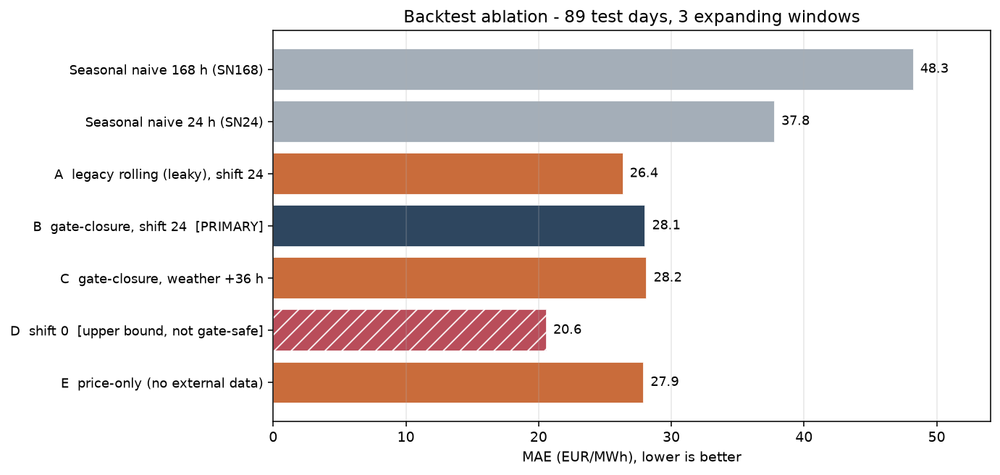
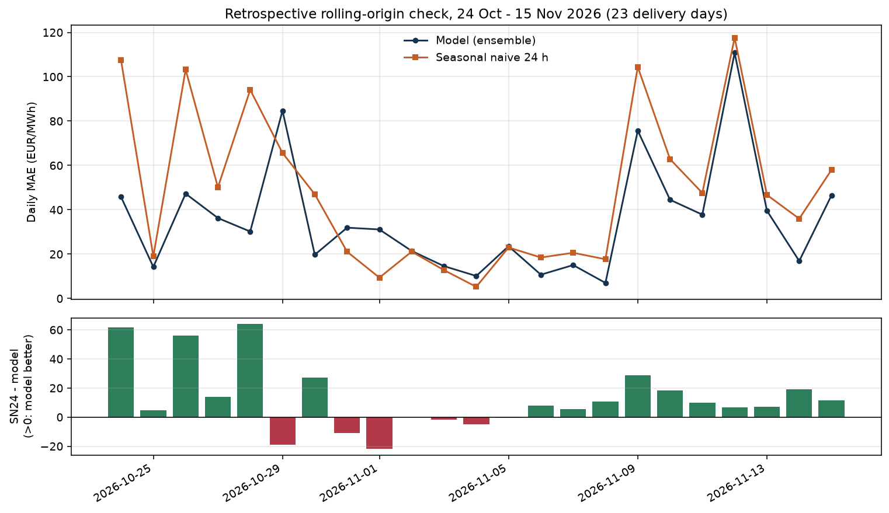
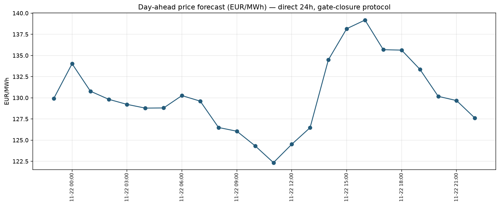

# Germany Day-Ahead Electricity Price Forecast

Leakage-aware forecasting of German EPEX Spot day-ahead prices (DE/LU, EUR/MWh) under an explicit **gate-closure** information set, evaluated against realised day-ahead prices and seasonal-naive baselines.

**Author:** Azizallah Farhadi · `farhadmy1974@gmail.com`
**Status:** Research prototype (updated Nov 2026) · **Repository:** https://github.com/AZFARHAD24511/germany-electricity-price-forecast

---

## Key findings (as of the latest run)

<!-- KEY_START -->
1. **Gate-safe model beats seasonal naive.** 26 % lower MAE than SN24 in an 89-day backtest and 27 % in a 26-day retrospective rolling check (section 5).
2. **The original rolling features leaked.** Removing the leak costs 1.68 EUR/MWh (6.0 % of MAE).
3. **External data add no skill at a 24 h lag** (a price-only model is as good). Un-lagged externals would lower MAE by 7.4 EUR/MWh, but only if forecasts available before gate closure can be sourced.
4. **No claim about live performance yet.** Valid pre-gate live days are counted in the live block at the end of this file.
<!-- KEY_END -->

---

## 1. Motivation

Day-ahead price forecasts support trading, risk management, flexibility dispatch and sectoral impact analysis. The main modelling risk is **look-ahead bias**: using information that was not available at auction gate closure (12:00 CET on day D-1 for delivery day D).

## 2. Data

| Source | Content | Coverage (approx.) |
|--------|---------|---------------------|
| Hourly market data | Day-ahead price (EUR/MWh) | 2020-2026 |
| SMARD chart-data endpoint | Day-ahead wind & solar forecasts | 2022-2026 |
| Weather archive / Open-Meteo | Regional temperature, 100 m wind, shortwave radiation | 2022-2026 |

**Limitations.** The SMARD `/app/chart_data/...` endpoint is *not* an official Bundesnetzagentur API; `meta_data.created` is not a reliable issue time, so the publication time of the wind/solar forecasts relative to gate closure is unverified. The weather archive may contain reanalysis (observed) values rather than true forecasts. Raw CSVs are stored in `data/raw/` and refreshed by the daily job (`scripts/update_data.py`).

## 3. Leakage-control protocol (gate closure)

Primary protocol: `price_info="gate"`, `external_shift=24`.

| Feature family | Availability rule |
|----------------|-------------------|
| Price lags (24, 48, 72, 168, 336 h) | Always >= 24 h, hence inside day D-1 or earlier |
| Price context (mean/std/min/max/last of D-1, 7-day mean/std) | Only **complete Berlin days up to D-1** |
| Calendar / German federal holidays | Always known |
| SMARD wind/solar | Lagged **24 h** |
| Weather | Lagged 24 h (strict variant: 36 h, ablation C) |

The legacy features (`shift(1).rolling`) used price(t-1) of the delivery day itself and are kept only as ablation row A. `tests/test_leakage.py` checks that changing any price of the delivery day leaves all gate-closure features unchanged.

## 4. Method

1. **Features:** lags and complete-day context above, cyclical calendar encodings, holidays, lagged externals.
2. **Model:** `HistGradientBoostingRegressor` + `Ridge`, ensemble weights 0.65 / 0.35.
3. **Horizon:** **direct** 24 h forecast for the Berlin delivery date (no recursion: every input is a real observation).
4. **Post-processing:** shrunk hourly bias correction estimated from *raw* past forecasts (not part of the results below).
5. **Flags in every forecast file:** `pre_gate`, `gate_closure_utc`, `data_gap_hours`, `rows_with_imputed_features`.
6. **Baselines:** SN24 (same hour yesterday) and SN168 (same hour last week). Tests: Diebold-Mariano with HLN correction on daily losses.

Entry points: `scripts/run_daily_forecast.py` (live), `scripts/run_rolling_eval.py` (replay of the live procedure; `--incremental` adds only new days), `scripts/run_ablation.py` (ablation + DM), `scripts/update_readme_results.py` (rebuild the generated README sections from the metric CSVs).

<!-- RESULTS_START -->

## 5. Results

_Auto-generated by `scripts/run_ablation.py` / `scripts/run_rolling_eval.py` - last update 2026-11-18 10:04 UTC._

### 5.1 Backtest ablation (gate-closure protocol)

Expanding-window backtest, 89 test days (2136 hours) in three windows. p-values: one-sided Diebold-Mariano test (daily losses, Harvey-Leybourne-Newbold correction) that the model beats the baseline. This section is refreshed whenever `scripts/run_ablation.py` is run (its three test windows are fixed: Jul-Oct 2026).

| Setup | MAE | RMSE | rMAE vs SN24 | rMAE vs SN168 | p vs SN24 | Note |
|-------|-----|------|--------------|---------------|-----------|------|
| SN24 (same hour yesterday) | 37.79 | - | 1.00 | - | - | baseline |
| SN168 (same hour last week) | 48.26 | - | - | 1.00 | - | baseline |
| A  legacy rolling (leaky), shift 24 | 26.37 | 35.95 | 0.698 | 0.547 | <0.001 | uses price(t-1): not available at gate closure |
| **B  gate-closure, shift 24  [PRIMARY]** | **28.05** | 40.52 | 0.742 | 0.581 | <0.001 | primary, leak-free price features |
| C  gate-closure, weather +36 h | 28.16 | 40.37 | 0.745 | 0.584 | <0.001 | strict availability for observed weather |
| D  shift 0  [upper bound, not gate-safe] | 20.60 | 29.66 | 0.545 | 0.427 | <0.001 | upper bound: assumes externals known at gate closure |
| E  price-only (no external data) | 27.93 | 40.28 | 0.739 | 0.579 | <0.001 | tests whether externals add skill |



- **Leak size.** The legacy `shift(1).rolling` features flattered MAE by 1.68 EUR/MWh (6.0 %) compared with the gate-closure features.
- **Primary result (B).** MAE 28.05 vs SN24 37.79: 26 % lower error than seasonal naive 24 h (DM p <0.001).
- **External data add no measurable skill at a 24 h lag** (price-only MAE 27.93 vs 28.05). The current model is effectively a price-only model.
- **Upper bound (D).** Un-lagged external data would lower MAE by 7.45 EUR/MWh (27 %). This is NOT a result: it requires wind/solar/weather *forecasts* that were demonstrably published before 12:00 CET on D-1, and the weather archive may contain reanalysis rather than forecasts.

### 5.2 Retrospective rolling-origin check (same code as the live job)

For each Berlin delivery day 2026-10-24 to 2026-11-18 the data from that day onward is hidden, the ensemble is retrained, and a direct 24 h forecast is scored. This is a **replay**, not a live pre-gate record.

| Days | MAE model | MAE SN24 | MAE SN168 | Days model < SN24 | Days model < better of SN24/SN168 | DM p vs SN24 (daily) |
|------|-----------|----------|-----------|-------------------|-----------------------------------|----------------------|
| 26 | **36.26** | 49.77 | 103.37 | 18/26 | 16/26 | 0.002 |



Days on which the model lost to SN24: 2026-10-29, 2026-10-31, 2026-11-01, 2026-11-02, 2026-11-03, 2026-11-04, 2026-11-05, 2026-11-17. "Better of SN24/SN168" is chosen after seeing the day's outcome and is a deliberately harsh yardstick; the primary comparison is SN24.

### 5.3 What is NOT yet established

- **No valid live record yet.** Earlier daily files were produced by superseded code and named by run date, not delivery date; they are archived in `outputs/forecasts/legacy/` and excluded. Valid pre-gate days are counted in the live block below.
- Short samples (one season, 89 + 23 days). Regime changes (e.g. gas-price shocks) are not covered.
- Bias correction has not been evaluated separately; the results above are without it.
- Hourly resolution only; the day-ahead market moved to 15-minute products on 1 Oct 2025.
- Point forecasts only (no uncertainty); no economic-value evaluation yet.

<!-- RESULTS_END -->

---

## 6. Repository structure

```text
germany-electricity-price-forecast/
├── data/raw/                      # raw CSVs (refreshed daily)
├── src/electricity_forecast/      # data, features, train, evaluate, report
├── scripts/
│   ├── update_data.py
│   ├── forecast_horizon.py        # direct 24 h forecast
│   ├── bias_correction.py
│   ├── run_daily_forecast.py      # live job (updates the live block below)
│   ├── run_ablation.py            # writes reports/metrics/ablation.csv + section 5.1
│   ├── run_rolling_eval.py        # writes reports/metrics/rolling_eval.csv + section 5.2
│   └── update_readme_results.py
├── tests/test_leakage.py
├── reports/{figures,metrics,methodology}/
├── outputs/{forecasts,figures}/   # live forecasts (legacy files in forecasts/legacy/)
├── run_daily.bat                  # daily job: forecast -> evaluation -> README -> git push
├── CHANGES.md
└── README.md
```

## 7. Quick start

```bash
git clone https://github.com/AZFARHAD24511/germany-electricity-price-forecast.git
cd germany-electricity-price-forecast
python -m venv .venv && source .venv/bin/activate   # Windows: .venv\Scripts\activate
pip install -r requirements.txt && pip install -e .

# full CSVs into data/raw/, then:
python scripts/run_ablation.py     --price data/raw/germany_electricity_hourly.csv --smard data/raw/germany_smard_day_ahead_forecasts.csv --weather data/raw/germany_weather_forecast_archive.csv
python scripts/run_rolling_eval.py --price data/raw/germany_electricity_hourly.csv --smard data/raw/germany_smard_day_ahead_forecasts.csv --weather data/raw/germany_weather_forecast_archive.csv --start 2026-10-24 --end 2026-11-16
python scripts/run_daily_forecast.py     # schedule before 10:00 UTC (gate closes 11:00 UTC in winter)
python scripts/run_rolling_eval.py --incremental
pytest tests/ -q
```

On Windows, schedule `run_daily.bat` in Task Scheduler (daily, ~09:00 Berlin time).

## How this README stays up to date

`run_daily.bat` (scheduled around 09:00 Berlin time, i.e. before the 12:00 CET gate) runs the whole chain and pushes the result:

| Step | Command | What it refreshes in this README |
|------|---------|----------------------------------|
| 1 | `scripts/run_daily_forecast.py` | **Live daily forecast** block at the end (forecast table, chart, scored days, `Counted` flags) |
| 2 | `scripts/run_rolling_eval.py --incremental` | **Key findings** and **section 5.2** (adds the newest complete delivery day, rebuilds figures and DM test) |
| 3 | `git add / commit / pull --rebase / push` | publishes forecasts, figures, metrics and README |

Section 5.1 (ablation) changes only when `scripts/run_ablation.py` is run manually (its test windows are fixed). Hand-written sections (1-4, 6-9) are never touched by the scripts.

## 8. Roadmap

- [x] Gate-closure feature set, direct delivery-day forecast, leakage tests
- [x] Ablation and rolling-origin evaluation with DM tests
- [ ] >= 60 valid live pre-gate days before any live-performance claim
- [ ] Forecast sources with verifiable publication times (wind/solar/weather run times)
- [ ] Price-level drivers (gas, CO2) and a model anchored on lag-24 (predict the change)
- [ ] Quantile forecasts and economic-value evaluation
- [ ] 15-minute day-ahead products
- [ ] FIGARO sectoral shock module (separate track)

## 9. Licence & attribution

Code: MIT. Market data remain under their original terms. SMARD-related series: *Bundesnetzagentur | SMARD.de* (the chart-data endpoint itself is third-party).

<!-- DAILY_FORECAST_START -->

## Live daily forecast

**Generated (UTC):** 2026-11-19 11:34  
**Based on data up to (UTC):** 2026-11-19 22:00  
**Forecast horizon (UTC):** 2026-11-19 23:00 to 2026-11-20 22:00  
**Protocol:** gate-closure features (lags >= 24 h, complete-day context) + external_shift = 24 + ENTSO-E load (no shift) + direct 24h + shrunk hourly bias correction

### Forecast chart



### Forecast table (EUR/MWh)

| Hour (UTC) | Forecast (EUR/MWh) | Bias |
|------------|--------------------|------|
| 2026-11-19 23:00 | 183.85 | 0.00 |
| 2026-11-20 00:00 | 177.77 | 0.00 |
| 2026-11-20 01:00 | 179.49 | 0.00 |
| 2026-11-20 02:00 | 182.19 | 0.00 |
| 2026-11-20 03:00 | 181.77 | 0.00 |
| 2026-11-20 04:00 | 183.01 | 0.00 |
| 2026-11-20 05:00 | 196.35 | 0.00 |
| 2026-11-20 06:00 | 208.36 | 0.00 |
| 2026-11-20 07:00 | 220.12 | 0.00 |
| 2026-11-20 08:00 | 202.02 | 0.00 |
| 2026-11-20 09:00 | 198.52 | 0.00 |
| 2026-11-20 10:00 | 189.74 | 0.00 |
| 2026-11-20 11:00 | 183.70 | 0.00 |
| 2026-11-20 12:00 | 184.63 | 0.00 |
| 2026-11-20 13:00 | 195.96 | 0.00 |
| 2026-11-20 14:00 | 205.73 | 0.00 |
| 2026-11-20 15:00 | 214.92 | 0.00 |
| 2026-11-20 16:00 | 219.63 | 0.00 |
| 2026-11-20 17:00 | 215.21 | 0.00 |
| 2026-11-20 18:00 | 214.25 | 0.00 |
| 2026-11-20 19:00 | 205.62 | 0.00 |
| 2026-11-20 20:00 | 192.45 | 0.00 |
| 2026-11-20 21:00 | 191.18 | 0.00 |
| 2026-11-20 22:00 | 184.74 | 0.00 |

### Previous forecasts vs realized prices

| Forecast file | Hours | MAE | SN24 | SN168 | rMAE vs SN24 | rMAE vs SN168 | Pre-gate | Counted |
|---------------|-------|-----|------|-------|--------------|---------------|----------|---------|
| `forecast_2026-11-16.csv` | 24 | 20.65 | 66.10 | 151.15 | 0.31 | 0.14 | False | no: not pre-gate |
| `forecast_2026-11-17.csv` | 24 | 55.82 | 46.58 | 139.90 | 1.20 | 0.40 | True | yes |
| `forecast_2026-11-18.csv` | 24 | 51.79 | 72.19 | 170.40 | 0.72 | 0.30 | True | yes |
| `forecast_2026-11-19.csv` | 24 | 40.31 | 78.58 | 36.01 | 0.51 | 1.12 | True | yes |

**Valid scored days: 3 | mean MAE model 49.31 | SN24 65.78 | SN168 115.44 | best-of-baselines 51.59**

**Days model beats SN24: 2/3 | beats the better of SN24/SN168: 1/3**

_Only rows marked 'Counted = yes' enter the summary. Files from the old code (Pre-gate nan), post-gate runs and duplicate delivery days are shown for transparency but not counted. No statistical claim until >= 60 valid days._


_If the vs-actual chart is missing, there is not yet enough overlap with realized prices._

<!-- DAILY_FORECAST_END -->
