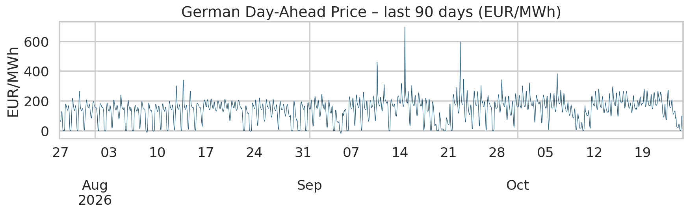
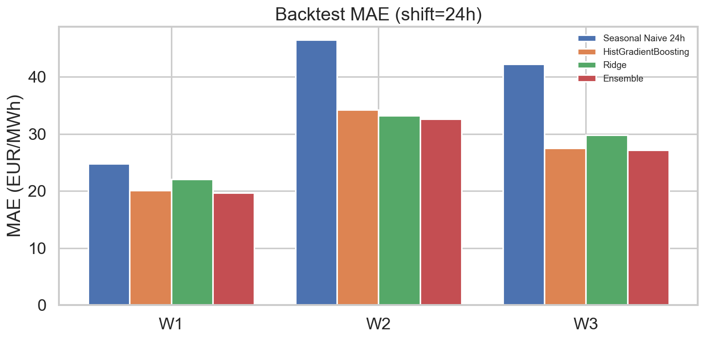
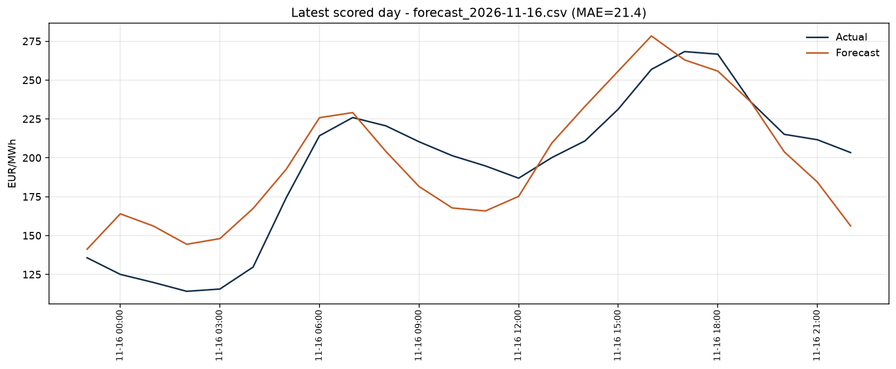

# Germany Day-Ahead Electricity Price Forecast

Leakage-aware forecasting of German EPEX Spot day-ahead prices (EUR/MWh), with a transparent **Conservative** protocol for external forecasts.

**Author:** Azizallah Farhadi · `farhadmy1974@gmail.com`  
**Status:** Research prototype (Oct 2026)

---

## 1. Motivation

Accurate day-ahead price forecasts support:

- Trading and risk management on the German/Luxembourg bidding zone
- Demand-side flexibility and storage dispatch
- Sectoral impact analysis when electricity prices rise (linked to FIGARO input–output tables in the broader project)

The main modelling risk is **data leakage**: using wind/solar forecasts that were not yet published when the day-ahead auction closed (~12:00 CET on day *D* for delivery on *D+1*).

---

## 2. Data

| Source | Content | Coverage (approx.) |
|--------|---------|---------------------|
| Hourly market data | Day-ahead price, load, residual load, generation by technology | 2020–2026 |
| SMARD chart-data endpoint | Day-ahead wind & solar generation forecasts | 2022–2026 |
| Weather archive | Regional temperature, 100 m wind, shortwave radiation | 2022–2026 |

> **Important limitation (official clarification, 29 Oct 2026)**  
> The SMARD chart-data endpoint (`/app/chart_data/...`) is **not an official API** of the Bundesnetzagentur. It is a third-party project. The `meta_data.created` timestamps therefore **cannot** be treated as the original issue time of the forecasts. An official SMARD API is under development.

Raw files live under `data/raw/` and are **excluded from Git** (see `.gitignore`). Only small samples or processed summaries should be committed.

---

## 3. Leakage-Control Protocol (Conservative)

Because true issue times are unavailable, we enforce a strict rule:

| Feature family | Rule |
|----------------|------|
| Price lags & rolling statistics | Only information up to the end of day *D−1* |
| Calendar / cyclical encodings | Always available |
| SMARD wind/solar + weather | **Shifted by +24 hours** |

All **primary results** in this repository use `external_shift = 24`.  
Optimistic runs (`shift = 0`) are kept only as sensitivity analysis and are clearly labelled.

Full write-up: [`reports/methodology/CONSERVATIVE_LEAKAGE.md`](reports/methodology/CONSERVATIVE_LEAKAGE.md)

---

## 4. Method

1. **Features**  
   - Price lags: 24, 48, 72, 168, 336 h  
   - Rolling mean/std (24 h, 168 h)  
   - Hour / day-of-week / month + sine-cosine encodings  
   - External forecasts lagged by 24 h

2. **Models**  
   - `HistGradientBoostingRegressor` (tree-based)  
   - `Ridge` regression (linear baseline with scaling)  
   - **Ensemble** = 0.65 × HGB + 0.35 × Ridge

3. **Evaluation**  
   Expanding-window backtest on three recent periods (Jul–Aug, Aug–Sep, Sep–Oct 2026).  
   Metrics: MAE and RMSE (EUR/MWh).  
   Reference: seasonal naïve (lag 24 h).

---

## 5. Results (Conservative protocol)

> **Status note (Nov 2026):** the table below was produced with the *legacy* rolling features
> (`shift(1).rolling`), which use price(t-1) and are not available at gate closure. These numbers are
> therefore optimistic. Re-run `python scripts/run_ablation.py ...` (row `B_gate_shift24` is the new
> primary result, row `A_legacy_shift24` reproduces this table) and replace the table before citing it.


Weighted averages over the three test windows:

| Model | MAE (EUR/MWh) | RMSE (EUR/MWh) | Improvement vs SN24 |
|-------|----------------|----------------|---------------------|
| Seasonal Naive 24 h | 37.79 | — | — |
| Ridge | 28.31 | — | ≈ 25 % |
| HistGradientBoosting | 26.85 | — | ≈ 29 % |
| **Ensemble** | **26.27** | **35.14** | **≈ 30 %** |

Per-window detail is in [`reports/metrics/ensemble_summary.csv`](reports/metrics/ensemble_summary.csv).

### Figures

> Place generated plots under `reports/figures/`. After running the pipeline they appear as:

**Price series overview**



**Backtest MAE comparison**



**Example prediction vs actual (one window)**


*(Run `scripts/run_pipeline.py` to regenerate the figures.)*

---

## 6. Repository Structure

```
germany-electricity-price-forecast/
├── data/
│   ├── raw/                  # large CSVs – not tracked by Git
│   └── processed/
├── models/                   # fitted model artefacts (optional)
├── reports/
│   ├── figures/              # PNG charts for README & paper
│   ├── metrics/              # CSV + JSON summaries
│   └── methodology/          # leakage protocol & SMARD note
├── scripts/
│   └── run_pipeline.py       # end-to-end Conservative run
├── src/
│   └── electricity_forecast/
│       ├── data.py           # load & join
│       ├── features.py       # leakage-aware feature engineering
│       ├── train.py          # HGB + Ridge ensemble
│       ├── evaluate.py       # expanding-window backtest
│       └── visualize.py      # report figures
├── tests/
├── notebooks/                # exploratory work (optional)
├── .gitignore
├── pyproject.toml
├── requirements.txt
└── README.md
```

---

## 7. Quick Start

```bash
# clone & install
git clone <your-repo-url>
cd germany-electricity-price-forecast
python -m venv .venv
source .venv/bin/activate   # Windows: .venv\Scripts\activate
pip install -r requirements.txt
pip install -e .

# place raw CSVs into data/raw/
# then run the Conservative pipeline
python scripts/run_pipeline.py \
  --price   data/raw/germany_electricity_hourly.csv \
  --smard   data/raw/germany_smard_day_ahead_forecasts.csv \
  --weather data/raw/germany_weather_forecast_archive.csv \
  --out     reports \
  --shift   24
```

Tests:

```bash
pytest tests/ -q
```

---

## 8. Analysis Highlights

- **Hardest periods** are those with high renewable penetration and negative or near-zero prices; residual-load and lag features help, but residual error remains elevated (see window 2).
- The 24 h shift costs roughly 4–5 EUR/MWh of MAE relative to an optimistic (and potentially leaking) setting. We accept this cost for methodological integrity.
- Tree models (HGB) capture non-linear interactions between wind/solar forecasts and the residual load better than pure linear Ridge; the ensemble improves further by blending both.
- Because the external forecasts lack a reliable issue time, any future improvement should prioritise a source that publishes true run times (official SMARD API or ENTSO-E with available-at timestamps).

---

## 9. Roadmap

- [x] Leakage-safe baseline & ensemble (Conservative)
- [x] Document SMARD API limitation
- [ ] Sectoral price-shock analysis via FIGARO product-by-product tables
- [ ] Optional LSTM / sequence model branch
- [ ] Switch to official SMARD API once issue-time metadata is available

---

## 10. Citation & Licence

If you use this code or results, please cite the repository and note the Conservative protocol.

Data attribution for SMARD-sourced series: *Bundesnetzagentur | SMARD.de* (even though the chart-data endpoint itself is third-party).

Licence: MIT (code). Underlying market data remain subject to their original licences.

<!-- DAILY_FORECAST_START -->

## Live daily forecast

**Generated (UTC):** 2026-11-15 11:51  
**Based on data up to (UTC):** 2026-11-15 22:00  
**Forecast horizon (UTC):** 2026-11-15 23:00 to 2026-11-16 22:00  
**Protocol:** gate-closure features (lags >= 24 h, complete-day context) + external_shift = 24 + direct 24h + shrunk hourly bias correction

### Forecast chart


### Forecast table (EUR/MWh)

| Hour (UTC) | Forecast (EUR/MWh) | Bias |
|------------|--------------------|------|
| 2026-11-15 23:00 | 141.23 | -13.62 |
| 2026-11-16 00:00 | 163.94 | -20.29 |
| 2026-11-16 01:00 | 156.06 | -18.51 |
| 2026-11-16 02:00 | 144.34 | -17.48 |
| 2026-11-16 03:00 | 148.00 | -17.53 |
| 2026-11-16 04:00 | 167.37 | -9.36 |
| 2026-11-16 05:00 | 192.65 | -9.33 |
| 2026-11-16 06:00 | 225.75 | -17.78 |
| 2026-11-16 07:00 | 229.03 | -21.19 |
| 2026-11-16 08:00 | 204.05 | -17.68 |
| 2026-11-16 09:00 | 181.46 | -15.58 |
| 2026-11-16 10:00 | 168.30 | -14.36 |
| 2026-11-16 11:00 | 167.04 | -13.22 |
| 2026-11-16 12:00 | 174.98 | -12.63 |
| 2026-11-16 13:00 | 209.48 | -12.11 |
| 2026-11-16 14:00 | 234.60 | -15.83 |
| 2026-11-16 15:00 | 255.69 | -18.25 |
| 2026-11-16 16:00 | 278.32 | -12.89 |
| 2026-11-16 17:00 | 262.90 | -7.77 |
| 2026-11-16 18:00 | 255.76 | -9.51 |
| 2026-11-16 19:00 | 235.78 | -5.45 |
| 2026-11-16 20:00 | 201.93 | -2.16 |
| 2026-11-16 21:00 | 182.40 | -7.21 |
| 2026-11-16 22:00 | 156.13 | -9.42 |

### Previous forecasts vs realized prices

| Forecast file | Hours | MAE | SN24 | SN168 | rMAE vs SN168 | Pre-gate |
|---------------|-------|-----|------|-------|---------------|----------|
| `forecast_2026-10-31.csv` | 24 | 67.09 | 9.32 | 241.66 | 0.28 | nan |
| `forecast_2026-11-01.csv` | 24 | 65.43 | 21.26 | 163.01 | 0.40 | nan |
| `forecast_2026-11-02.csv` | 24 | 18.75 | 12.43 | 93.69 | 0.20 | nan |
| `forecast_2026-11-03.csv` | 24 | 16.60 | 6.02 | 16.75 | 0.99 | nan |
| `forecast_2026-11-04.csv` | 24 | 15.31 | 13.02 | 54.30 | 0.28 | nan |
| `forecast_2026-11-05.csv` | 24 | 37.02 | 18.49 | 14.01 | 2.64 | nan |
| `forecast_2026-11-07.csv` | 24 | 16.96 | 17.62 | 20.95 | 0.81 | nan |
| `forecast_2026-11-08.csv` | 24 | 82.04 | 62.83 | 99.37 | 0.83 | nan |
| `forecast_2026-11-10.csv` | 24 | 100.49 | 117.60 | 60.41 | 1.66 | nan |
| `forecast_2026-11-11.csv` | 24 | 119.75 | 46.70 | 113.90 | 1.05 | nan |
| `forecast_2026-11-12.csv` | 24 | 31.60 | 35.98 | 62.11 | 0.51 | nan |

**Complete days: 11 | mean MAE 51.91 | mean SN24 32.84 | mean SN168 85.47 | days model beats SN168: 8/11**

_rMAE < 1 means the model beat the seasonal-naive baseline that day. Short samples: no statistical claim until >= 60 complete pre-gate days._



_If the vs-actual chart is missing, there is not yet enough overlap with realized prices._

<!-- DAILY_FORECAST_END -->
