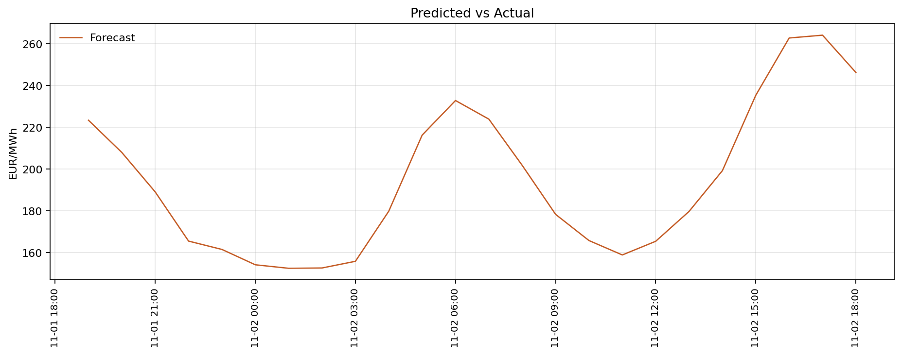

# Germany Day-Ahead Electricity Price Forecast

Leakage-aware forecasting of German EPEX Spot day-ahead prices (EUR/MWh) under an explicit **gate-closure** information set.

**Author:** Azizallah Farhadi · `farhadmy1974@gmail.com`  
**Status:** Research prototype (updated Nov 2026)  
**Repository:** https://github.com/AZFARHAD24511/germany-electricity-price-forecast

---

## 1. Motivation

Day-ahead price forecasts support trading, risk management, flexibility dispatch, and sectoral impact analysis when electricity prices move.

The main modelling risk is **data leakage**: using information that was not available at auction gate closure (~12:00 CET on day **D−1** for delivery day **D**).

---

## 2. Data

| Source | Content | Coverage (approx.) |
|--------|---------|---------------------|
| Hourly market data | Day-ahead price (EUR/MWh) | 2020–2026 |
| SMARD chart-data endpoint | Day-ahead wind & solar forecasts | 2022–2026 |
| Weather archive / Open-Meteo | Regional temperature, 100 m wind, shortwave radiation | 2022–2026 |

**Important limitation:** the SMARD `/app/chart_data/...` endpoint is **not** an official Bundesnetzagentur API. `meta_data.created` is **not** a reliable issue time. An official SMARD API is under development.

Raw files: `data/raw/` (gitignored).

---

## 3. Leakage-control protocol (gate closure)

Primary protocol (`price_info="gate"`, `external_shift=24`):

| Feature family | Availability rule |
|----------------|-------------------|
| Price lags & day-level context | Only **complete days through D−1** (no prices from delivery day D) |
| Calendar / holidays | Always known |
| SMARD wind/solar | Shifted by **+24 h** |
| Weather | Default +24 h; optional stricter **+36 h** in ablation |

Legacy `shift(1).rolling` features are **not** the primary protocol. They can use hour *t−1* on day D and are **optimistic** relative to true gate closure. See `CHANGES.md` and `reports/methodology/CONSERVATIVE_LEAKAGE.md`.

---

## 4. Method (current)

1. **Features** — lags ≥ 24 h from D−1 context, calendar encodings, German federal holidays, lagged externals  
2. **Model** — HistGradientBoosting + Ridge ensemble (weights ≈ 0.65 / 0.35)  
3. **Horizon** — **direct** 24 h forecast for the Berlin **delivery date** (not recursive hour-by-hour)  
4. **Post-process** — hourly bias correction from **raw** predictions (shrinkage; min. observations)  
5. **Flags** — `pre_gate`, `gate_closure_utc`, `data_gap_hours`

Daily entry point: `scripts/run_daily_forecast.py`  
Ablation / DM tests: `scripts/run_ablation.py`  
Leakage tests: `tests/test_leakage.py`

---

## 5. Results — read this first

### 5.1 Legacy backtest (optimistic — not gate-safe)

Produced with **legacy** rolling features. Do **not** cite as gate-safe performance. Re-run `python scripts/run_ablation.py` and use row **`B_gate_shift24`**.

| Model | MAE (EUR/MWh) | Notes |
|-------|----------------|--------|
| Seasonal Naive 24 h | ~37.8 | Reference (legacy windows) |
| Ensemble (legacy features) | ~26.3 | **Optimistic — not gate-safe** |

**Price series overview**


**Backtest MAE comparison**


**Example prediction vs actual (one window)**



*(Regenerate with `python scripts/run_pipeline.py` if images are missing.)*

### 5.2 Live operational scores

Updated by the daily job below. Older files may have `pre_gate = nan`.  
No strong statistical claim until ≥ ~60 complete **pre-gate** days are scored.

---

## 6. Repository structure

```text
germany-electricity-price-forecast/
├── data/raw/
├── src/electricity_forecast/
├── scripts/
│   ├── update_data.py
│   ├── forecast_horizon.py
│   ├── bias_correction.py
│   ├── run_daily_forecast.py
│   ├── run_ablation.py
│   └── run_pipeline.py
├── tests/test_leakage.py
├── reports/figures/
├── outputs/figures/
├── outputs/forecasts/
├── CHANGES.md
└── README.md
```

---

## 7. Quick start

```bash
git clone https://github.com/AZFARHAD24511/germany-electricity-price-forecast.git
cd germany-electricity-price-forecast
python -m venv .venv
# Windows: .venv\Scripts\activate
source .venv/bin/activate
pip install -r requirements.txt
pip install -e .

# put full CSVs into data/raw/
python scripts/run_daily_forecast.py
pytest tests/ -q
```

---

## 8. Roadmap

- [x] Conservative external shift (24 h) documented  
- [x] Gate-closure feature set + direct delivery-day forecast  
- [x] Leakage tests + ablation script  
- [ ] ≥ 60 pre-gate scored days before strong claims  
- [ ] Official issue-time data when available  
- [ ] Optional 15-minute Day-Ahead products  
- [ ] FIGARO sectoral shock module (separate track)

---

## 9. Licence & attribution

Code: MIT.  
Market data remain under their original terms.  
SMARD-related series: attribution *Bundesnetzagentur | SMARD.de* (chart-data endpoint is third-party).

<!-- DAILY_FORECAST_START -->

## Live daily forecast

**Generated (UTC):** 2026-11-15 16:32  
**Based on data up to (UTC):** 2026-11-15 22:00  
**Forecast horizon (UTC):** 2026-11-15 23:00 to 2026-11-16 22:00  
**Protocol:** gate-closure features (lags >= 24 h, complete-day context) + external_shift = 24 + direct 24h + shrunk hourly bias correction

### Forecast chart


### Forecast table (EUR/MWh)

| Hour (UTC) | Forecast (EUR/MWh) | Bias |
|------------|--------------------|------|
| 2026-11-15 23:00 | 141.23 | -13.62 |
| 2026-11-16 00:00 | 163.94 | -20.29 |
| 2026-11-16 01:00 | 156.06 | -18.51 |
| 2026-11-16 02:00 | 144.34 | -17.48 |
| 2026-11-16 03:00 | 148.00 | -17.53 |
| 2026-11-16 04:00 | 167.37 | -9.36 |
| 2026-11-16 05:00 | 192.65 | -9.33 |
| 2026-11-16 06:00 | 225.77 | -17.78 |
| 2026-11-16 07:00 | 229.06 | -21.19 |
| 2026-11-16 08:00 | 204.09 | -17.68 |
| 2026-11-16 09:00 | 181.51 | -15.58 |
| 2026-11-16 10:00 | 167.71 | -14.36 |
| 2026-11-16 11:00 | 165.78 | -13.22 |
| 2026-11-16 12:00 | 175.17 | -12.63 |
| 2026-11-16 13:00 | 209.49 | -12.11 |
| 2026-11-16 14:00 | 233.10 | -15.83 |
| 2026-11-16 15:00 | 255.73 | -18.25 |
| 2026-11-16 16:00 | 278.36 | -12.89 |
| 2026-11-16 17:00 | 262.92 | -7.77 |
| 2026-11-16 18:00 | 255.74 | -9.51 |
| 2026-11-16 19:00 | 235.77 | -5.45 |
| 2026-11-16 20:00 | 203.87 | -2.16 |
| 2026-11-16 21:00 | 184.36 | -7.21 |
| 2026-11-16 22:00 | 156.18 | -9.42 |

### Previous forecasts vs realized prices

| Forecast file | Hours | MAE | SN24 | SN168 | rMAE vs SN168 | Pre-gate |
|---------------|-------|-----|------|-------|---------------|----------|
| `forecast_2026-10-31.csv` | 24 | 67.09 | 9.32 | 241.66 | 0.28 | nan |
| `forecast_2026-11-01.csv` | 24 | 65.43 | 21.26 | 163.01 | 0.40 | nan |
| `forecast_2026-11-02.csv` | 24 | 18.75 | 12.43 | 93.69 | 0.20 | nan |
| `forecast_2026-11-03.csv` | 24 | 16.60 | 6.02 | 16.75 | 0.99 | nan |
| `forecast_2026-11-04.csv` | 24 | 15.31 | 13.02 | 54.30 | 0.28 | nan |
| `forecast_2026-11-05.csv` | 24 | 37.02 | 18.49 | 14.01 | 2.64 | nan |
| `forecast_2026-11-07.csv` | 24 | 16.96 | 17.62 | 20.95 | 0.81 | nan |
| `forecast_2026-11-08.csv` | 24 | 82.04 | 62.83 | 99.37 | 0.83 | nan |
| `forecast_2026-11-10.csv` | 24 | 100.49 | 117.60 | 60.41 | 1.66 | nan |
| `forecast_2026-11-11.csv` | 24 | 119.75 | 46.70 | 113.90 | 1.05 | nan |
| `forecast_2026-11-12.csv` | 24 | 31.60 | 35.98 | 62.11 | 0.51 | nan |
| `forecast_2026-11-14.csv` | 24 | 27.72 | 66.10 | 151.15 | 0.18 | nan |
| `forecast_2026-11-15.csv` | 24 | 22.30 | 66.10 | 151.15 | 0.15 | nan |
| `forecast_2026-11-16.csv` | 24 | 21.39 | 66.10 | 151.15 | 0.14 | False |

**Complete days: 14 | mean MAE 45.89 | mean SN24 39.97 | mean SN168 99.54 | days model beats SN168: 11/14**

_rMAE < 1 means the model beat the seasonal-naive baseline that day. Short samples: no statistical claim until >= 60 complete pre-gate days._


_If the vs-actual chart is missing, there is not yet enough overlap with realized prices._

<!-- DAILY_FORECAST_END -->
