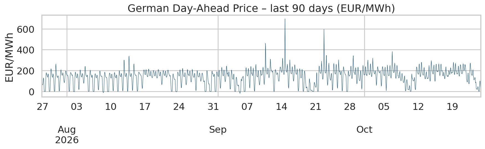
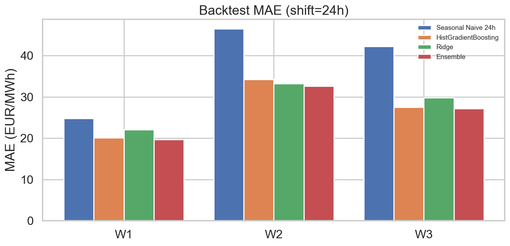
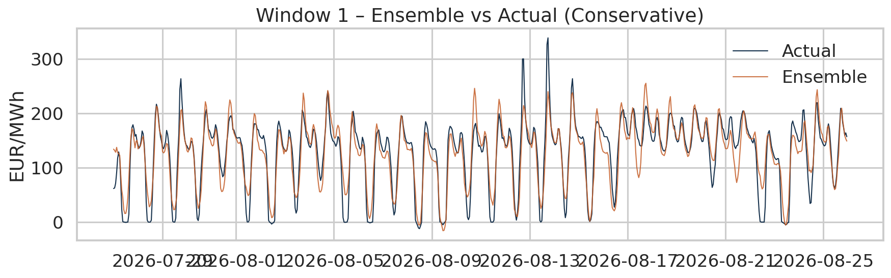
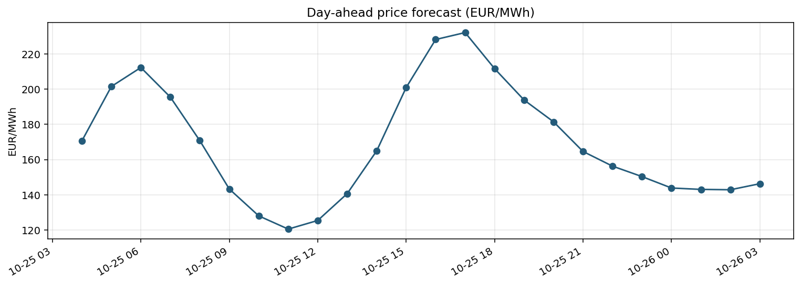
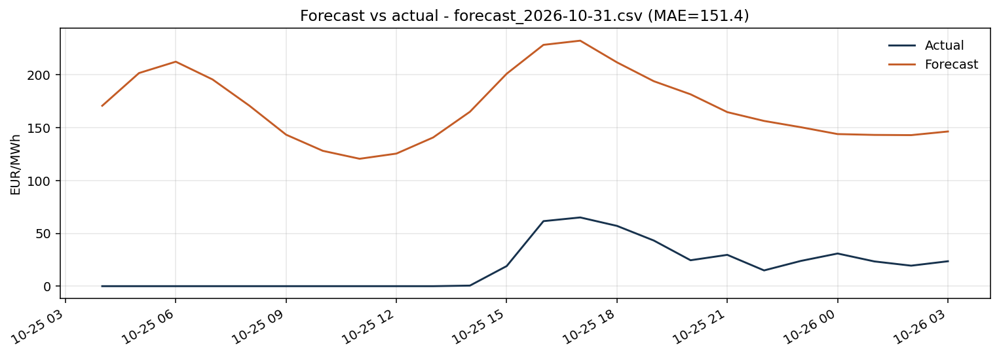

# Germany Day-Ahead Electricity Price Forecast

Leakage-aware forecasting of German EPEX Spot day-ahead prices (EUR/MWh), with a transparent **Conservative** protocol for external forecasts.

**Author:** Azizallah Farhadi · `farhadmy1974@gmail.com`  
**Status:** Research prototype (Oct 2026)

---

## 1. Motivation

Accurate day-ahead price forecasts support:

- Trading and risk management on the German/Luxembourg bidding zone
- Demand-side flexibility and storage dispatch
- Sectoral impact analysis when electricity prices rise (linked to FIGARO input–output tables in the broader project)

The main modelling risk is **data leakage**: using wind/solar forecasts that were not yet published when the day-ahead auction closed (~12:00 CET on day *D* for delivery on *D+1*).

---

## 2. Data

| Source | Content | Coverage (approx.) |
|--------|---------|---------------------|
| Hourly market data | Day-ahead price, load, residual load, generation by technology | 2020–2026 |
| SMARD chart-data endpoint | Day-ahead wind & solar generation forecasts | 2022–2026 |
| Weather archive | Regional temperature, 100 m wind, shortwave radiation | 2022–2026 |

> **Important limitation (official clarification, 29 Oct 2026)**  
> The SMARD chart-data endpoint (`/app/chart_data/...`) is **not an official API** of the Bundesnetzagentur. It is a third-party project. The `meta_data.created` timestamps therefore **cannot** be treated as the original issue time of the forecasts. An official SMARD API is under development.

Raw files live under `data/raw/` and are **excluded from Git** (see `.gitignore`). Only small samples or processed summaries should be committed.

---

## 3. Leakage-Control Protocol (Conservative)

Because true issue times are unavailable, we enforce a strict rule:

| Feature family | Rule |
|----------------|------|
| Price lags & rolling statistics | Only information up to the end of day *D−1* |
| Calendar / cyclical encodings | Always available |
| SMARD wind/solar + weather | **Shifted by +24 hours** |

All **primary results** in this repository use `external_shift = 24`.  
Optimistic runs (`shift = 0`) are kept only as sensitivity analysis and are clearly labelled.

Full write-up: [`reports/methodology/CONSERVATIVE_LEAKAGE.md`](reports/methodology/CONSERVATIVE_LEAKAGE.md)

---

## 4. Method

1. **Features**  
   - Price lags: 24, 48, 72, 168, 336 h  
   - Rolling mean/std (24 h, 168 h)  
   - Hour / day-of-week / month + sine-cosine encodings  
   - External forecasts lagged by 24 h

2. **Models**  
   - `HistGradientBoostingRegressor` (tree-based)  
   - `Ridge` regression (linear baseline with scaling)  
   - **Ensemble** = 0.65 × HGB + 0.35 × Ridge

3. **Evaluation**  
   Expanding-window backtest on three recent periods (Jul–Aug, Aug–Sep, Sep–Oct 2026).  
   Metrics: MAE and RMSE (EUR/MWh).  
   Reference: seasonal naïve (lag 24 h).

---

## 5. Results (Conservative protocol – locked)

Weighted averages over the three test windows:

| Model | MAE (EUR/MWh) | RMSE (EUR/MWh) | Improvement vs SN24 |
|-------|----------------|----------------|---------------------|
| Seasonal Naive 24 h | 37.79 | — | — |
| Ridge | 28.31 | — | ≈ 25 % |
| HistGradientBoosting | 26.85 | — | ≈ 29 % |
| **Ensemble** | **26.27** | **35.14** | **≈ 30 %** |

Per-window detail is in [`reports/metrics/ensemble_summary.csv`](reports/metrics/ensemble_summary.csv).

### Figures

> Place generated plots under `reports/figures/`. After running the pipeline they appear as:

**Price series overview**



**Backtest MAE comparison**



**Example prediction vs actual (one window)**



*(Run `scripts/run_pipeline.py` to regenerate the figures.)*

---

## 6. Repository Structure

```
germany-electricity-price-forecast/
├── data/
│   ├── raw/                  # large CSVs – not tracked by Git
│   └── processed/
├── models/                   # fitted model artefacts (optional)
├── reports/
│   ├── figures/              # PNG charts for README & paper
│   ├── metrics/              # CSV + JSON summaries
│   └── methodology/          # leakage protocol & SMARD note
├── scripts/
│   └── run_pipeline.py       # end-to-end Conservative run
├── src/
│   └── electricity_forecast/
│       ├── data.py           # load & join
│       ├── features.py       # leakage-aware feature engineering
│       ├── train.py          # HGB + Ridge ensemble
│       ├── evaluate.py       # expanding-window backtest
│       └── visualize.py      # report figures
├── tests/
├── notebooks/                # exploratory work (optional)
├── .gitignore
├── pyproject.toml
├── requirements.txt
└── README.md
```

---

## 7. Quick Start

```bash
# clone & install
git clone <your-repo-url>
cd germany-electricity-price-forecast
python -m venv .venv
source .venv/bin/activate   # Windows: .venv\Scripts\activate
pip install -r requirements.txt
pip install -e .

# place raw CSVs into data/raw/
# then run the Conservative pipeline
python scripts/run_pipeline.py \
  --price   data/raw/germany_electricity_hourly.csv \
  --smard   data/raw/germany_smard_day_ahead_forecasts.csv \
  --weather data/raw/germany_weather_forecast_archive.csv \
  --out     reports \
  --shift   24
```

Tests:

```bash
pytest tests/ -q
```

---

## 8. Analysis Highlights

- **Hardest periods** are those with high renewable penetration and negative or near-zero prices; residual-load and lag features help, but residual error remains elevated (see window 2).
- The 24 h shift costs roughly 4–5 EUR/MWh of MAE relative to an optimistic (and potentially leaking) setting. We accept this cost for methodological integrity.
- Tree models (HGB) capture non-linear interactions between wind/solar forecasts and the residual load better than pure linear Ridge; the ensemble improves further by blending both.
- Because the external forecasts lack a reliable issue time, any future improvement should prioritise a source that publishes true run times (official SMARD API or ENTSO-E with available-at timestamps).

---

## 9. Roadmap

- [x] Leakage-safe baseline & ensemble (Conservative)
- [x] Document SMARD API limitation
- [ ] Sectoral price-shock analysis via FIGARO product-by-product tables
- [ ] Optional LSTM / sequence model branch
- [ ] Switch to official SMARD API once issue-time metadata is available

---

## 10. Citation & Licence

If you use this code or results, please cite the repository and note the Conservative protocol.

Data attribution for SMARD-sourced series: *Bundesnetzagentur | SMARD.de* (even though the chart-data endpoint itself is third-party).

Licence: MIT (code). Underlying market data remain subject to their original licences.

<!-- DAILY_FORECAST_START -->

## Live daily forecast

**Generated (UTC):** 2026-10-31 15:18  
**Based on data up to (UTC):** 2026-10-25 03:00  
**Forecast horizon (UTC):** 2026-10-25 04:00 to 2026-10-26 03:00  
**Protocol:** Conservative (external_shift = 24)

### Forecast chart



### Forecast table (EUR/MWh)

| Hour (UTC) | Forecast (EUR/MWh) |
|------------|--------------------|
| 2026-10-25 04:00 | 170.65 |
| 2026-10-25 05:00 | 201.57 |
| 2026-10-25 06:00 | 212.34 |
| 2026-10-25 07:00 | 195.53 |
| 2026-10-25 08:00 | 170.77 |
| 2026-10-25 09:00 | 143.29 |
| 2026-10-25 10:00 | 128.01 |
| 2026-10-25 11:00 | 120.50 |
| 2026-10-25 12:00 | 125.40 |
| 2026-10-25 13:00 | 140.66 |
| 2026-10-25 14:00 | 164.97 |
| 2026-10-25 15:00 | 200.96 |
| 2026-10-25 16:00 | 228.26 |
| 2026-10-25 17:00 | 232.21 |
| 2026-10-25 18:00 | 211.69 |
| 2026-10-25 19:00 | 193.88 |
| 2026-10-25 20:00 | 181.48 |
| 2026-10-25 21:00 | 164.62 |
| 2026-10-25 22:00 | 156.29 |
| 2026-10-25 23:00 | 150.35 |
| 2026-10-26 00:00 | 143.86 |
| 2026-10-26 01:00 | 143.07 |
| 2026-10-26 02:00 | 142.87 |
| 2026-10-26 03:00 | 146.31 |

### Previous forecasts vs realized prices

| Forecast file | Hours scored | MAE | RMSE |
|---------------|--------------|-----|------|
| `forecast_2026-10-31.csv` | 24 | 151.38 | 153.84 |



_If the vs-actual chart is missing, there is not yet enough overlap with realized prices._

<!-- DAILY_FORECAST_END -->
